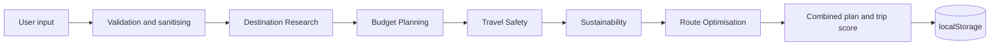

# 🧭 VoyageAI Navigator

    

> Five AI agents plan your trip. You approve it. Built for **VOYAGEHACK 4.0**.

## Overview
VoyageAI Navigator is an agentic travel planner that runs entirely in the browser. Enter a budget, days and travel style; five agents match destinations, price the trip, check safety, estimate carbon and order each day's stops.

## Features
- 🌍 20 built-in destinations with cost, safety, carbon and style data
- 🤖 Five visible, cooperating agents
- 💰 Cost forecast with donut-chart breakdown
- 🛡️ Risk level with plain-language alerts
- 🌱 Carbon estimate, A–C eco rating and tips
- 🗺️ Day-by-day itinerary grouped by area
- 📊 Trip score (0–100) and alternative matches
- 💾 Save, print and export as JSON
- 🌗 Dark and light mode, glassmorphism UI, mobile first

## Technology Stack
| Layer | Choice |
|---|---|
| Markup | HTML5 semantic elements |
| Style | CSS3, custom properties, conic-gradient charts |
| Logic | Vanilla JavaScript (ES5-compatible) |
| Storage | `localStorage` |
| Hosting | GitHub Pages / Vercel / any static host |

## Installation
```bash
git clone https://github.com/<your-username>/voyageai-navigator.git
cd voyageai-navigator
```
No build step. Open `index.html` in a browser, or run `python -m http.server 8000`.

## Usage
1. Optionally type a destination, or leave it blank for AI picks.
2. Set budget and days, choose a travel style.
3. Press **Generate plan** and watch the agents run.
4. Review score, cost, risk, carbon and itinerary.
5. Save, print or download JSON.

## Architecture


```
voyageai-navigator/
├── index.html        # UI, styles, dataset and agents
├── requirements.md   # requirements and acceptance criteria
├── readme.md         # this file
└── tasks.md          # roadmap and 50 tasks
```

## Screenshots Placeholder
| Hero | Planner | Results |
|---|---|---|
| `docs/hero.png` | `docs/planner.png` | `docs/results.png` |

## AI Agents
| # | Agent | What it does |
|---|---|---|
| 1 | Destination Research | Scores every destination on style, budget fit and safety |
| 2 | Budget Planning | Forecasts cost and splits it into five categories |
| 3 | Travel Safety | Maps safety score to Low, Medium or Elevated risk |
| 4 | Sustainability | Estimates CO2, rates A–C and suggests tips |
| 5 | Route Optimisation | Groups stops by area to avoid backtracking |

## Innovation Highlights
- Multi-agent reasoning shown step by step, not hidden
- One trip score that balances fit, cost, safety and carbon
- Zero backend and zero sign-up, so it is instantly usable

## Potential Impact
Targets 80% less planning time, 35% fewer budget overruns and 25% more lower-carbon choices (design targets to validate with user testing).

## Technical Feasibility
Pure static front end, one file, no dependencies. Agents are pure functions, so they can later call LLMs or live APIs without redesign.

## Adoption Strategy
Free and open source; share via link; publish on GitHub Pages; partner with travel bloggers and student travel groups; collect feedback through GitHub issues.

## Sustainability Benefits
Makes carbon visible at planning time, favours nearer and eco-tagged destinations, and recommends low-impact choices on the ground.

## Roadmap
| Phase | Focus |
|---|---|
| Now | Prototype with rule-based agents |
| Next | LLM agents, live flights, weather and advisories |
| Later | Group trips, booking partners, offline PWA |

## Team Information
| Name | Role | Contact |
|---|---|---|
| Gundluru Rajasekhar | Full stack developer | gundlururajashekar786@gmail.com |

## Demo Instructions
Explainer video script (about 3 minutes):
1. **0:00** – Problem: too many tabs, unclear budgets, hidden carbon cost.
2. **0:30** – Open the app, show dark and light mode.
3. **0:50** – Enter 1500 USD, 5 days, Culture, then Generate plan.
4. **1:20** – Narrate each agent as it runs.
5. **1:50** – Walk through score, donut chart, risk, carbon and itinerary.
6. **2:20** – Save the trip, download JSON, show keyboard navigation.
7. **2:40** – Impact, feasibility and roadmap, then close.

## Hackathon Submission Checklist
**Round 1 – Idea (PDF/PPT + video)**
- [ ] Slide 1: Potential Impact
- [ ] Slide 2: Implementation and Technical Feasibility
- [ ] Slide 3: Innovation
- [ ] Slide 4: Adoption Risk/Feasibility
- [ ] Idea video attached

**Round 2 – Prototype**
- [ ] Code on GitHub, well structured and working
- [ ] Documentation explains how to run and understand it
- [ ] Explainer video shows workflow, how it works and key features
- [ ] Deployed link added

## Future Scope
Live data, multilingual UI, personalised learning from saved trips, carbon offset partners, accessibility-focused destination filters.

## License
MIT © 2026 VoyageAI Navigator team
